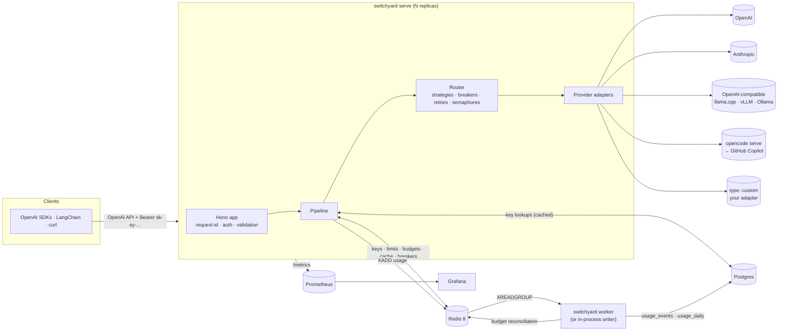

# Architecture

Switchyard is one Node.js process type (`switchyard serve`), plus an optional worker
(`switchyard worker`) and a one-shot `switchyard migrate`. They all come from the same package
and image. Redis and Postgres are optional: without them the gateway is a stateless,
config-driven proxy, and with them it becomes a multi-tenant platform. Decisions and their
trade-offs are recorded in [docs/adr/](adr/README.md).

## Components

| Layer         | Code                                                                                      | Responsibility                                                                     |
| ------------- | ----------------------------------------------------------------------------------------- | ---------------------------------------------------------------------------------- |
| HTTP          | `app.ts`, `http/validation.ts`, `admin/routes.ts`                                         | Hono routes, request ids, auth, zod validation, SSE, admin API, health and metrics |
| Config        | `config/*`                                                                                | YAML → `${ENV}` interpolation → zod → `ResolvedConfig` (immutable snapshot)        |
| Pipeline      | `core/pipeline.ts`                                                                        | Per-request policy: route, estimate, limits, budget, cache, dispatch, accounting   |
| Routing       | `core/router.ts`, `core/strategies.ts`, `resilience/*`                                    | Target order, breakers, concurrency slots, retries, timeouts, streaming commit     |
| Providers     | `providers/*`                                                                             | Translate canonical (OpenAI-shaped) requests to each upstream and back             |
| Services      | `core/services.ts` + implementations                                                      | Interfaces for keys, limits, budgets, cache, usage, breakers (memory or Redis/PG)  |
| Platform      | `platform/*`, `auth/db-key-store.ts`, `limits/redis-*`, `cache/redis-cache.ts`, `usage/*` | Redis/Postgres implementations, invalidation bus, usage worker                     |
| Observability | `observability/*`                                                                         | pino logger, Prometheus metrics                                                    |
| CLI           | `cli.ts`, `cli/*`                                                                         | `init`, `serve`, `worker`, `migrate`, admin commands, `mock-provider`              |

## Request lifecycle

The path for `POST /v1/chat/completions`, in order. Embeddings and rerank follow the same shape
without streaming. Embeddings cache per input item.

1. **Request id:** a safe client `x-request-id` is kept, otherwise one is generated. A child
   logger is created with the id.
2. **Auth:** Bearer or `x-api-key` → `KeyStore.verify`. Static keys are checked first. Database
   keys must be well formed (`sk-sy-` plus 40 base62 characters). They are looked up by SHA-256
   in a per-process cache (5 s), then in Redis (60 s), then in Postgres. Revocations are pushed
   to every replica over Redis pub/sub.
3. **Validation:** zod checks the shape. Unknown fields pass through to OpenAI-family upstreams.
4. **Route resolution:** `model` names a route, or a model when the key may call models
   directly. The key's `allowed_routes` is enforced, and route defaults (`max_tokens`,
   `temperature`, `reasoning_effort`) are applied.
5. **Estimate:** `js-tiktoken` counts prompt tokens. With `max_tokens × n`, that gives a
   pre-flight token count and an upper-bound cost.
6. **Rate limits:** one Lua call checks key and team RPM/TPM all-or-nothing and reserves the
   TPM estimate ([ADR 0003](adr/0003-lua-sliding-window-limits.md)). A rejection is a 429 with
   `x-ratelimit-*` and `retry-after` headers.
7. **Budget:** `spent + preflight ≤ limit` for every team budget, otherwise 402
   ([ADR 0006](adr/0006-budgets-preflight-reconciliation.md)).
8. **Cache:** the exact cache (canonical request hash, per team unless shared) is checked first,
   then the semantic cache if enabled ([ADR 0005](adr/0005-semantic-cache-redis-vector-sets.md)).
   A hit is answered directly. Streaming requests get a synthesized stream. Cost is 0, and the
   saved cost is reported.
9. **Dispatch:** the router orders targets by strategy (`fallback`, `weighted`,
   `least-latency`) and skips disabled targets and targets with an open breaker. Each attempt
   acquires a provider concurrency slot and calls the adapter with a scoped timeout. Retryable
   errors (429, 5xx, timeout, network) are retried with exponential backoff and full jitter,
   honouring `Retry-After` up to a cap, and then fall back to the next target. Client errors
   return immediately. A streaming attempt is committed when its first meaningful chunk
   arrives; before that, failures still fall back. After it, an error ends the stream with an
   error event and `[DONE]`.
10. **Accounting:** usage → cost (pricing table, cached and reasoning tokens handled). Then, in
    order: TPM reconciliation, budget increment, cache write (successful, cacheable responses
    only), `UsageSink.emit` (non-blocking), metrics and response headers. `usage.cost` and
    `usage.sy_cache` are added to the response body, or to the final streamed usage chunk when
    `stream_options.include_usage` is set.

Client disconnects abort the upstream request through the request's `AbortSignal`.

## Streaming

Adapters return `AsyncIterable<ChatChunk>` in OpenAI's chunk shape. The pipeline wraps the
iterable to:

- track TTFT;
- accumulate usage (from upstream usage chunks, or estimated);
- enforce the commit point for fallback;
- inject `usage.cost` into the final usage chunk;
- strip the usage chunk if the client didn't ask for it (upstream usage is always requested, so
  cost is exact);
- write the assembled response to the cache when the stream finishes.

Cache hits are replayed as roughly 20-token chunks with the same final usage chunk.

## Configuration snapshots and reload

A config version produces a **snapshot**: provider registry, router and pipeline. A reload
(SIGHUP, `POST /admin/config/reload` or `gateway.reload()`) builds a new snapshot and swaps it
in one step. Requests hold a reference to the snapshot they started on, so in-flight requests
and open streams finish on the old providers. The old snapshot is closed when its last request
completes. Platform settings that can change at runtime (limits, budget settings) are pushed to
the platform with `setConfig`. Connection URLs need a restart.

## Data and storage

**Redis**: everything lives under `redis.key_prefix` (default `sy:`):

- key-record cache;
- sliding-window rate-limit hashes;
- budget counters and alert dedupe keys;
- exact-cache entries (gzip when large);
- semantic vector sets;
- circuit-breaker state;
- the invalidation pub/sub channel;
- the usage stream and its dead-letter stream.

The Lua scripts touch several keys at once, so use a single primary (with replicas or Sentinel)
rather than Redis Cluster. The exact layout and TTLs are in
[docs/ADMIN.md § Redis key layout](ADMIN.md#9-redis-key-layout).

**Postgres** (drizzle migrations shipped in the package, `switchyard migrate`):

- `teams`, `api_keys` (hash only), `budgets`, `audit_log`;
- `usage_events`, range-partitioned by month (partitions created ahead, dropped after
  `retention_days`, idempotent on `(ts, request_id)`);
- `usage_daily` rollups, which back reports and budget reconciliation.

## Failure behaviour

| Failure                        | Behaviour                                                                                                                                             |
| ------------------------------ | ----------------------------------------------------------------------------------------------------------------------------------------------------- |
| Upstream 5xx / timeout         | Retry, then fall back. The breaker opens after the failure rate or consecutive-failure threshold.                                                     |
| All targets failing            | 503 `upstream_unavailable` with `retry-after`, or 504 when the route deadline expires.                                                                |
| Redis down                     | `fail_open: true` (default): limits, budgets and Redis caches are skipped (logged), and usage events are buffered in memory. `fail_open: false`: 503. |
| Postgres down                  | Static and cached keys keep working. Uncached database keys get 503, never 401. Usage waits in the stream.                                            |
| Worker down                    | Usage accumulates in the stream, bounded by `MAXLEN`. Budgets stay correct through Redis counters.                                                    |
| Startup without Redis/Postgres | `serve` starts anyway after `connect_timeout_ms`, logs a hint and reports not-ready on `/readyz` until they are reachable.                            |
| SIGTERM                        | `/readyz` → 503, stop accepting, drain in-flight requests up to `shutdown_grace_ms`, flush usage, close.                                              |

## Deployment shapes

- **Single process:** `switchyard serve` with `usage.in_process_writer: true`. Redis and
  Postgres are optional.
- **Scaled:** N stateless `serve` replicas behind a load balancer, one or more `worker`s, and a
  shared Redis 8 and Postgres. The Helm chart ships this shape, with a migration hook, HPA, PDB
  and ServiceMonitor ([docs/DEPLOYMENT.md](DEPLOYMENT.md)).
- **Embedded:** inside your own Hono or Fetch-API app ([docs/LIBRARY.md](LIBRARY.md)).
