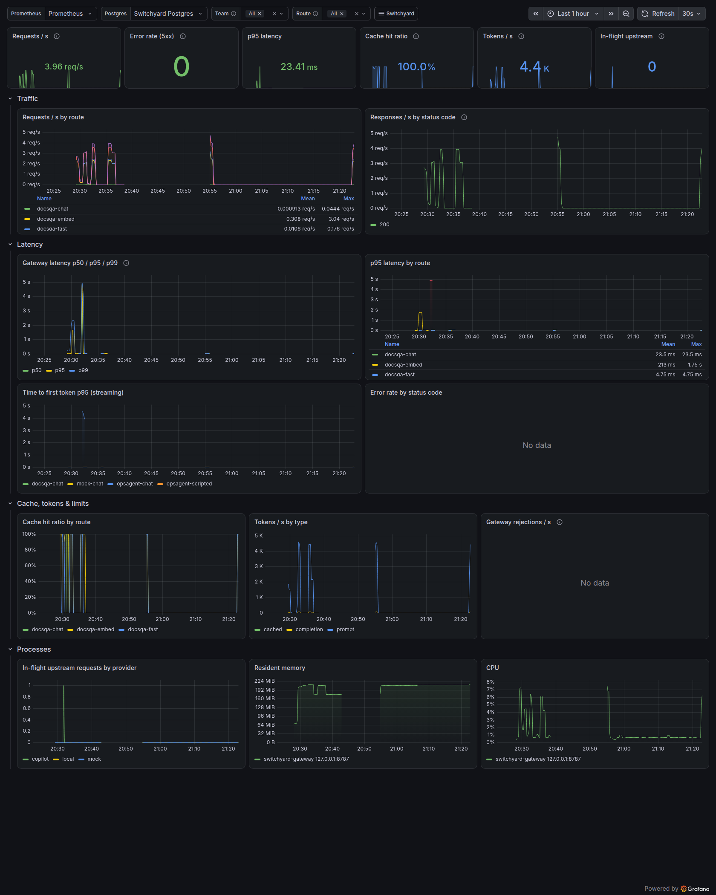
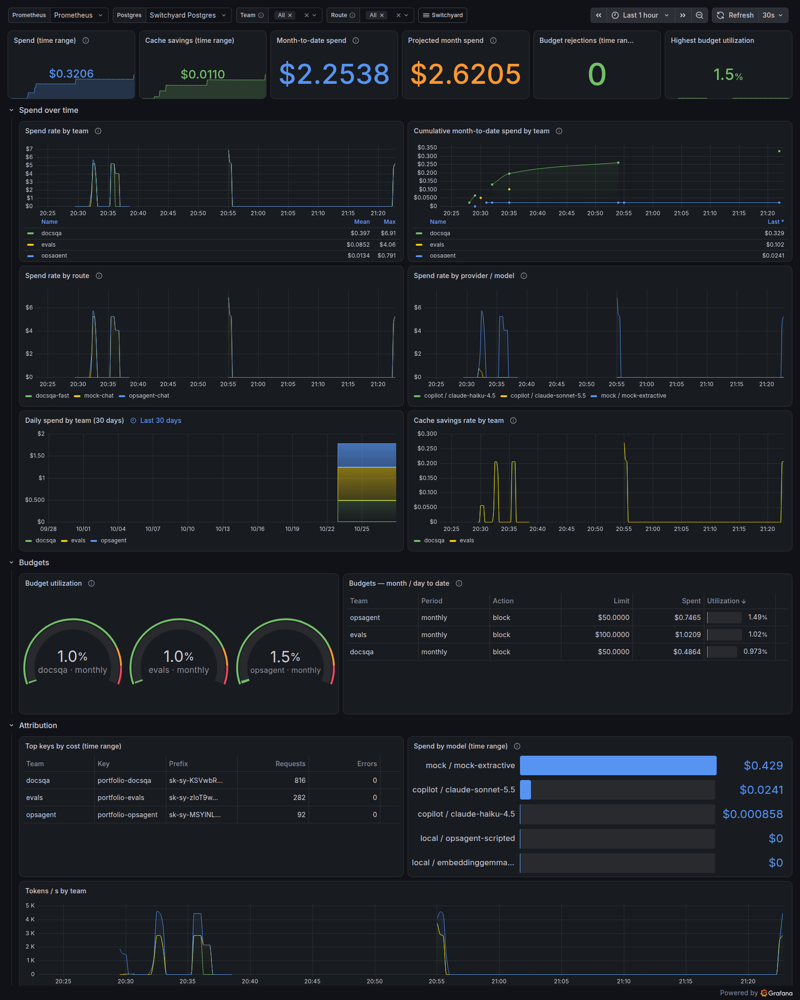
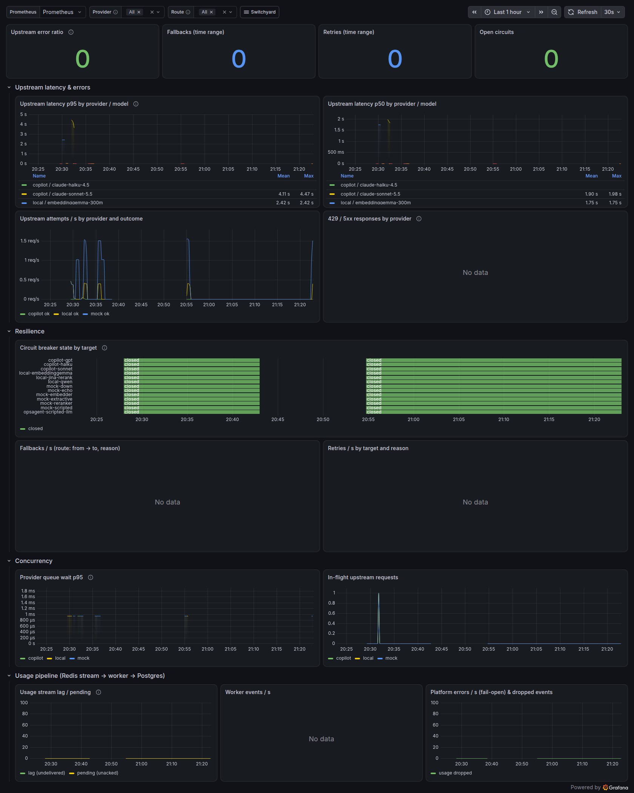
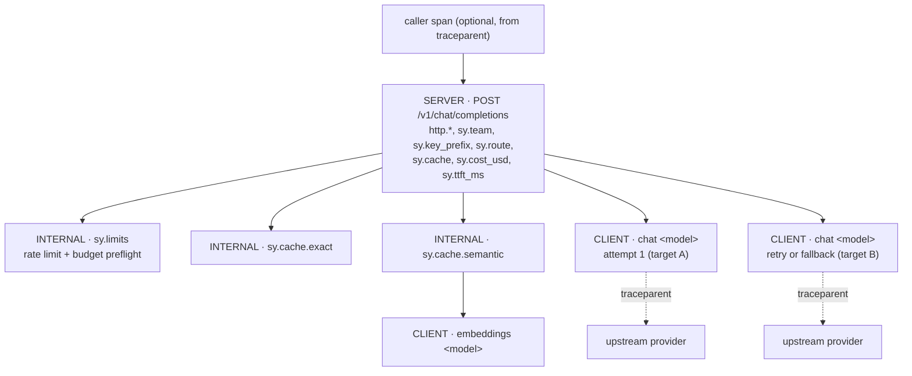

# Observability

Switchyard exposes Prometheus metrics, persists every request to Postgres, exports OpenTelemetry
traces when enabled, and ships three Grafana dashboards plus alert rules that use the metrics and
Postgres. The metric names and labels are documented in [METRICS.md](METRICS.md). This page
covers the dashboards, [tracing](#tracing), the alerts and the runbooks.

| Piece                     | Source                                                                                                     |
| ------------------------- | ---------------------------------------------------------------------------------------------------------- |
| Gateway metrics           | `serve`, on `metrics.port` (9464 in compose and the chart; never on the API port)                          |
| Worker metrics and health | `worker --port 9465`: `/metrics`, `/healthz`                                                               |
| Request-level data        | Postgres `llmgateway`: `usage_events` (monthly partitions), `usage_daily`, `teams`, `budgets`, `api_keys`  |
| Dashboards                | `observability/grafana/dashboards/*.json`, generated by `generate-dashboards.mjs`                          |
| Alert rules               | `observability/prometheus/alerts.yml` (+ unit tests in `alerts.test.yml`)                                  |
| Prometheus config         | `observability/prometheus/prometheus.yml` (compose)                                                        |
| Grafana provisioning      | `observability/grafana/provisioning/` (compose); ConfigMaps + kube-prometheus-stack values (Terraform)     |
| Traces                    | OTLP/HTTP from `serve` when `observability.otel.enabled`; Tempo config in `observability/tempo/tempo.yaml` |

## Dashboards

All three dashboards use Grafana schemaVersion 42 (Grafana 12/13) and live in the "Switchyard"
folder. They are templated:

- `datasource`: Prometheus datasource
- `pgds`: Postgres datasource
- `team`: from `SELECT slug FROM teams`
- `route`: from `label_values(sy_requests_total, route)`
- `provider`: on the Providers dashboard. Upstream metrics carry `provider`/`model` rather than
  `team`, so this dashboard filters by provider and route instead of team.

Panels are a mix of Prometheus (rates, latency, live state) and Postgres (month-to-date spend,
projections, budgets, top keys). Postgres queries go through the read-only `grafana_reader` role,
which has `pg_read_all_data`, read-only transactions and a 30 s statement timeout.

The JSON files are generated. Edit `observability/grafana/generate-dashboards.mjs` and run
`make dashboards`; CI runs `make dashboards-check`. To import into another Grafana, upload the
JSON files and pick the datasources for `datasource` and `pgds`.

### Overview (`switchyard-overview`)


- **Top row:** requests/s, 5xx error rate, p95 latency, cache hit ratio, tokens/s, in-flight
  upstream calls.
- **Traffic:** requests/s by route and responses/s by status code.
- **Latency:** gateway p50/p95/p99, p95 by route, streaming time-to-first-token p95, and error
  rate by status.
- **Cache, tokens & limits:** hit ratio by route, tokens/s by type, and gateway rejections (429
  rate limits, 402 budgets, auth) by reason.
- **Processes:** in-flight requests by provider, resident memory and CPU per instance.

### Cost & Budgets (`switchyard-cost`)


- **Top row:** spend and cache savings in the time range (Prometheus), month-to-date spend and a
  linear month projection (Postgres), budget rejections, and the highest budget utilization.
- **Spend over time:** spend rate by team, route and provider/model, cumulative month-to-date
  spend by team (Postgres, `date_bin` on `usage_events`), daily spend over 30 days
  (`usage_daily`), and cache savings rate by team.
- **Budgets:** a utilization gauge per team and period, plus a table of each budget, its month-
  and day-to-date spend and its utilization.
- **Attribution:** top keys by cost (joined to `api_keys` for names), spend by model, and
  tokens/s by team.

Prometheus cost counters reset when the process restarts, and `increase()` handles that. The
Postgres panels are the source of truth for invoicing-style questions.

### Providers & Reliability (`switchyard-providers`)


- **Top row:** upstream error ratio, fallbacks, retries and open circuits.
- **Upstream latency & errors:** p50/p95 by provider and model, attempts/s by outcome, and
  429/5xx by provider.
- **Resilience:** a state timeline of every breaker (closed / half-open / open), fallbacks/s
  labelled `route: from → to (reason)`, and retries/s by target and reason.
- **Concurrency:** provider queue-wait p95 and in-flight upstream requests.
- **Usage pipeline:** stream lag and pending entries, worker events/s (inserted, duplicate,
  dead-lettered), platform errors handled fail-open, and dropped usage events.

The screenshots come from the compose demo: three teams, a sandbox team over budget, a key
limited to 5 RPM, a 30 %-flaky primary and a 60 %-throttled primary. A kind run of the Cost
dashboard is in `observability/screenshots/switchyard-cost-kind.png`. To regenerate them, run
`make screenshots GRAFANA_URL=…`, which needs `uv` and Chrome (`capture.py --help`).

### From the dev gateway (real traffic, 2026-10-27)

The `dev-*` screenshots are the same dashboards against the gateway that serves the portfolio's
other two projects, [DocsQA](https://github.com/riz1-k/docsqa) and
[OpsAgent](https://github.com/riz1-k/opsagent), over one hour (20:22–21:22 IST) of their real
traffic: DocsQA personas through its API (streamed and sync, including exact-cache replays of
earlier Copilot answers), OpsAgent operator runs with approvals, and DocsQA eval runs as the
`evals` team. Per-team cost shows all three teams, each against its monthly budget.

| Overview                                                                   | Cost & budgets                                                     | Providers & reliability                                                      |
| -------------------------------------------------------------------------- | ------------------------------------------------------------------ | ---------------------------------------------------------------------------- |
|  |  |  |

How to read them:

- Copilot-served models are priced at **shadow** list prices (Copilot is flat-rate), and the
  deterministic `mock-extractive` model used for quota-free traffic carries a demo price
  ($0.50 / $1.50 per 1M tokens in `config/pricing.json`), so most of the spend in that hour is
  mock traffic; "Spend by model" separates it from the Copilot rows.
- Most OpsAgent traffic used its scripted model (a $0 local route), plus one real
  `opsagent-chat` run (2 Copilot calls). DocsQA's spend is mock traffic plus two Claude Haiku
  condense calls; its Copilot answers were exact-cache hits, which is why cache savings show.
- Fallbacks, retries, 429/5xx and rejections are empty because nothing failed in that hour; the
  failure-mode tests ran earlier with scratch teams. The hole in the breaker timeline and the
  process panels around 20:43–20:55 is missing Prometheus samples, not a gateway outage.

To reproduce against a gateway running on this host (Linux; Prometheus on :9092 and Grafana on
:3302, both host-networked):

```bash
make observe-host-up
make screenshots GRAFANA_URL=http://127.0.0.1:3302 SCREENSHOT_ARGS="--prefix=dev- --range now-1h"
make observe-host-down   # deletes the stack's volumes
```

## Tracing

With `observability.otel.enabled: true`, `switchyard serve` records one trace per `/v1/*` request
and exports it over OTLP/HTTP. A caller's W3C `traceparent` is continued, and the gateway sends
its own `traceparent` to the upstream, so one trace can run from the client through the gateway
into the provider. Tracing is off by default. When it is off, the OpenTelemetry SDK is never
imported and every tracing call is a no-op on the API's non-recording span.

### Setup

```yaml
observability:
  otel:
    enabled: true
    endpoint: http://127.0.0.1:4318 # OTLP/HTTP base URL; /v1/traces is appended
    sample_ratio: 0.1 # share of new traces to keep; a caller's decision always wins
    resource_attributes:
      deployment.environment.name: prod
```

The SDK packages are optional dependencies of `switchyard-gateway` (see
[ADR 0007](adr/0007-otel-sdk-packaging.md)). A normal install, the container image and the Helm
chart have them. If they were skipped (`--no-optional`), the gateway logs
`tracing enabled but the OpenTelemetry SDK could not be loaded; continuing without tracing`, with
an install hint, and serves without tracing.

Each key can also come from the standard variables. **A value in the config file wins**; an
`OTEL_*` variable fills in a key the file leaves unset; then the default applies.

| Setting             | Config key            | Variables (when the key is unset)                                                                 | Default                 |
| ------------------- | --------------------- | ------------------------------------------------------------------------------------------------- | ----------------------- |
| On/off              | `enabled`             | `OTEL_SDK_DISABLED=true` forces off, even when `enabled: true`                                    | off                     |
| Endpoint            | `endpoint`            | `OTEL_EXPORTER_OTLP_TRACES_ENDPOINT` (full URL), `OTEL_EXPORTER_OTLP_ENDPOINT`                    | `http://localhost:4318` |
| Export headers      | `headers`             | `OTEL_EXPORTER_OTLP_TRACES_HEADERS`, `OTEL_EXPORTER_OTLP_HEADERS`; merged, config wins per header | none                    |
| Service name        | `service_name`        | `OTEL_SERVICE_NAME`                                                                               | `switchyard`            |
| Sampling            | `sample_ratio`        | `OTEL_TRACES_SAMPLER` + `OTEL_TRACES_SAMPLER_ARG` (see below)                                     | 1                       |
| Resource attributes | `resource_attributes` | `OTEL_RESOURCE_ATTRIBUTES`; merged, config wins per key                                           | none                    |
| Propagators         | none                  | `OTEL_PROPAGATORS` (`tracecontext`, `baggage`; others are ignored)                                | `tracecontext,baggage`  |

Timeouts, compression and batch sizes use the exporter's and the batch processor's defaults
(`OTEL_EXPORTER_OTLP_TIMEOUT` and `OTEL_EXPORTER_OTLP_COMPRESSION` are read by the exporter). The
resource also carries `service.version` (the package version) and the SDK's `telemetry.sdk.*`
attributes. No host or process detectors run. Spans use the instrumentation scope
`switchyard-gateway`.

Export problems (collector down, 4xx) never fail a request. They are logged as
`tracing export problem` at most once per minute per message. On SIGTERM the gateway drains
in-flight requests, then flushes the remaining spans before it exits.

Tracing is wired into `switchyard serve` only. The `worker` process does not trace.

### Span model



- **SERVER span**, one per `/v1/*` request. It follows the HTTP server semconv: the name is
  `{method} {http.route}` (for example `POST /v1/chat/completions`), and attributes include
  `http.request.method`, `http.route`, `http.response.status_code`, `url.path`, `url.scheme`,
  `server.address`, `server.port` and `user_agent.original`. A 5xx response sets status ERROR
  and `error.type` to the status code. A 4xx leaves the status unset, as the semconv says for
  server spans, and the gateway's error code goes into `sy.error.code`. `/metrics`, `/healthz`,
  `/readyz` and `/admin/*` are not traced.
- **Stage spans** only where time is spent on the network:
  - `sy.limits` covers the rate-limit and budget-preflight round trip to Redis. It is skipped
    when neither limits nor budgets are configured.
  - `sy.cache.exact` and `sy.cache.semantic` cover cache lookups. A semantic lookup's
    embedding call is a CLIENT child of `sy.cache.semantic`.
  - Auth and route resolution are in-memory, so they become attributes (`sy.team`,
    `sy.key_prefix`, `sy.route`), not spans.
- **CLIENT span, one per upstream attempt.** Retries and fallbacks are siblings under the
  server span, so a fallback reads as two `chat <model>` spans, the first one red. The name is
  `{gen_ai.operation.name} {upstream model}`. The span covers queue wait (`sy.queue_wait_ms`),
  the HTTP call and, for streams, the whole stream.
- **Events:** `sy.retry_backoff` (target, delay) and `sy.target_skipped` (target, reason:
  `circuit_open`, `target_disabled` or `unsupported`) on the server span, and `sy.first_token` (`sy.ttft_ms`) when the
  first streamed token reaches the client.
- **Streaming:** the server span ends when the stream ends or the client disconnects, after the
  final usage and cost are on it. The attempt span records
  `gen_ai.response.time_to_first_chunk` (seconds, from the upstream) and the server span
  records `sy.ttft_ms` (milliseconds, as the client saw it). If the client disconnects
  mid-stream, the attempt span gets status ERROR with `error.type=aborted`. The server span
  keeps status 200, the status code the client already received.

Per-attempt spans are a deliberate deviation from the GenAI conventions. They say an inference
span "SHOULD cover the duration of the logical operation with all retries". Switchyard's
retries and fallbacks go to different targets, with different providers, models and costs, so
each attempt gets its own span and `gen_ai.*` attributes. The server span holds the logical
operation's totals (`sy.attempts`, `sy.fallbacks`, `sy.cost_usd`, `sy.usage.*`).

The in-process `mock` provider type makes no HTTP call, so its attempt spans have no
`server.address` and nothing to inject into. The standalone mock-provider server
(`openai-compatible` provider) records the `traceparent`, `tracestate` and `baggage` it receives
(`recent` in `GET /__mock/stats`), which the tests use.

### Attributes

GenAI attributes follow the OpenTelemetry semantic conventions for generative AI as of
[semantic-conventions-genai](https://github.com/open-telemetry/semantic-conventions-genai)
`main@51a0f58` (2026-10-27), which builds on semantic conventions v1.44.0. The GenAI conventions
are still in Development status, so names may change. Switchyard uses `gen_ai.provider.name`,
not the older `gen_ai.system`.

**Attempt span (CLIENT)**

| Attribute                                                                                                                                         | Example / values                                                                                                         |
| ------------------------------------------------------------------------------------------------------------------------------------------------- | ------------------------------------------------------------------------------------------------------------------------ |
| `gen_ai.operation.name`                                                                                                                           | `chat`, `embeddings`, `rerank` (custom value; no semconv operation exists)                                               |
| `gen_ai.provider.name`                                                                                                                            | provider type with `-` → `_`: `openai`, `anthropic`, `openai_compatible`, `opencode`, `mock`, `custom`                   |
| `gen_ai.request.model` / `gen_ai.response.model`                                                                                                  | upstream model id sent / returned                                                                                        |
| `gen_ai.response.id`, `gen_ai.response.finish_reasons`                                                                                            | `chatcmpl-…`, `["stop"]` (when the upstream returns them)                                                                |
| `gen_ai.usage.input_tokens` / `output_tokens`                                                                                                     | normalized usage, as billed                                                                                              |
| `gen_ai.usage.cache_read.input_tokens`, `gen_ai.usage.reasoning.output_tokens`                                                                    | when the upstream reports them                                                                                           |
| `gen_ai.request.max_tokens`, `temperature`, `top_p`, `frequency_penalty`, `presence_penalty`, `seed`, `choice.count`, `reasoning.level`, `stream` | chat requests, when set by the client                                                                                    |
| `gen_ai.output.type`                                                                                                                              | `text`, or `json` for the JSON `response_format` types                                                                   |
| `gen_ai.response.time_to_first_chunk`                                                                                                             | streams, seconds                                                                                                         |
| `gen_ai.embeddings.dimension.count`                                                                                                               | embeddings with `dimensions`                                                                                             |
| `server.address` / `server.port`                                                                                                                  | upstream host and port                                                                                                   |
| `error.type`                                                                                                                                      | gateway error code on failure: `upstream_unavailable`, `upstream_timeout`, `rate_limited`, `upstream_auth`, `aborted`, … |
| `sy.route`, `sy.target`, `sy.provider`                                                                                                            | route, model entry (target) and provider name from the config                                                            |
| `sy.attempt`, `sy.retry`                                                                                                                          | attempt number on this target (1-based); retries before it on this target (`sy.attempt` − 1)                             |
| `sy.retry.reason`                                                                                                                                 | on a retry: the error code of the previous attempt                                                                       |
| `sy.fallback.index`, `sy.fallback.reason`                                                                                                         | position of the target in the route (0 = primary); reason = error code that moved on                                     |
| `sy.circuit.state`                                                                                                                                | breaker state when the attempt started: `closed`, `half_open`                                                            |
| `sy.queue_wait_ms`                                                                                                                                | time waiting for a provider concurrency slot                                                                             |
| `sy.error.status`                                                                                                                                 | upstream HTTP status on failure                                                                                          |
| `sy.cost_usd`                                                                                                                                     | cost of this attempt                                                                                                     |

**Server span (SERVER)**, in addition to the HTTP attributes above

| Attribute                                         | Example / values                                                                                                                    |
| ------------------------------------------------- | ----------------------------------------------------------------------------------------------------------------------------------- |
| `sy.team`, `sy.key_prefix`                        | team slug and the key's display prefix (never the key)                                                                              |
| `sy.route`, `sy.stream`                           | route name; `true` for streams                                                                                                      |
| `sy.cache`                                        | `hit`, `semantic-hit`, `miss`, `bypass`                                                                                             |
| `sy.provider`, `sy.model`, `sy.target`            | what finally served the request                                                                                                     |
| `sy.attempts`, `sy.fallbacks`                     | number of attempts and fallbacks                                                                                                    |
| `sy.usage.input_tokens`, `sy.usage.output_tokens` | billed usage                                                                                                                        |
| `sy.cost_usd`, `sy.saved_usd`                     | request cost; what a cache hit saved                                                                                                |
| `sy.ttft_ms`                                      | streams                                                                                                                             |
| `sy.error.code`                                   | gateway error code: `budget_exceeded` (402), `rate_limit_exceeded` (429), `upstream_unavailable` (503), `upstream_timeout` (504), … |
| `error.type`                                      | 5xx only: the status code                                                                                                           |

**Stage spans:** `sy.ratelimit.result` and `sy.budget.result` (`allowed`, `rejected`) on
`sy.limits`; `sy.cache.result` (`hit`, `miss`; `error` for a failed semantic lookup) on the
cache spans.

Log lines written while a request span is recording carry `trace_id` and `span_id` (the server
span), next to `requestId`. Clients get the trace id in the `x-sy-trace-id` response header
([API.md](API.md#response-headers)).

### Sampling

The sampler is parent-based with a trace-id ratio for roots:

- A request with a `traceparent` follows the caller's decision. Sampled (`-01`) is always
  recorded; not sampled (`-00`) is never recorded, and the gateway still forwards the context
  upstream with the flag unchanged.
- A request without one starts a new trace, which is kept with probability `sample_ratio`.
- `OTEL_TRACES_SAMPLER` is honoured when `sample_ratio` is unset: `always_on` and
  `parentbased_always_on` mean 1, `always_off` and `parentbased_always_off` mean 0, and
  `traceidratio` and `parentbased_traceidratio` use `OTEL_TRACES_SAMPLER_ARG`. Switchyard
  always uses the parent-based form, so the caller's decision wins either way.

Unsampled requests create no spans, so no `x-sy-trace-id` header and no `trace_id` in logs.

### Privacy

Spans never carry prompts, completions, embeddings input, rerank documents, tool arguments or
API keys. The GenAI content attributes (`gen_ai.input.messages`, `gen_ai.output.messages`,
`gen_ai.system_instructions`) are not set, and there is no option to turn them on.
`observability.log_bodies` stays reserved and does not affect traces. What does go on spans:
model names, token counts, request parameters (temperature, max tokens, …), team slug, key
prefix, cost, and error messages from failed attempts clipped to 500 characters. An upstream
error message can quote parts of the request, so treat the trace backend like the logs.

Incoming `baggage` is propagated to upstreams unchanged when the `baggage` propagator is on.
Switchyard does not read it or put it on spans. Set `OTEL_PROPAGATORS=tracecontext` to stop
forwarding baggage to providers.

### Tempo in the local stacks

Both compose stacks run Grafana Tempo 3.1.1 (single binary, digest-pinned, local storage,
24 h retention, 256 MB memory limit). Grafana has a provisioned **Tempo** datasource. Its
trace-to-metrics links open the route's request rate and p95 latency, keyed by `sy.route`.

| Stack                                 | Tempo API (Grafana datasource) | OTLP/HTTP for other local services | Gateway exports       |
| ------------------------------------- | ------------------------------ | ---------------------------------- | --------------------- |
| Full stack (`make compose-up`)        | `127.0.0.1:3201`               | `127.0.0.1:4319`                   | on, to `tempo:4318`   |
| Host network (`make observe-host-up`) | `127.0.0.1:3200`               | `127.0.0.1:4318`                   | set it on the gateway |

In the full stack the gateway exports by default. Set `SWITCHYARD_OTEL_ENABLED=false` to turn it
off. For a gateway running on the host next to the observe-host stack:

```bash
make observe-host-up
OTEL_EXPORTER_OTLP_ENDPOINT=http://127.0.0.1:4318 switchyard serve   # with otel.enabled: true
curl -si http://127.0.0.1:8787/v1/chat/completions -H "Authorization: Bearer $KEY" \
  -H 'content-type: application/json' -d '{"model":"…","messages":[{"role":"user","content":"hi"}]}' \
  | grep -i x-sy-trace-id
curl -s http://127.0.0.1:3200/api/v2/traces/<trace id>   # or Grafana → Explore → Tempo
```

In Grafana, Explore → Tempo → Search finds traces by service, span name or attribute. A
TraceQL example: `{ resource.service.name = "switchyard" && span.sy.cache = "miss" && duration > 2s }`.
Other services (DocsQA, OpsAgent) can export to the same OTLP port and send `traceparent` to
the gateway. Their spans and the gateway's then share one trace.

On Kubernetes, the chart has a `tracing` block. See the
[chart README](../deploy/helm/switchyard/README.md#tracing).

## Alerts

`observability/prometheus/alerts.yml` defines three recording rules and eight alerts. Compose
loads the file directly. On Kubernetes, the chart ships it as a PrometheusRule
(`metrics.prometheusRule.enabled`). `make lint-alerts` runs `promtool check rules`, the unit
tests in `alerts.test.yml`, and a check that the chart copy is in sync.

| Alert                                                               | Condition                                        | For | Severity |
| ------------------------------------------------------------------- | ------------------------------------------------ | --- | -------- |
| [SwitchyardHighErrorRate](#switchyardhigherrorrate)                 | 5xx ratio > 5 % on a route with > 0.05 req/s     | 5m  | critical |
| [SwitchyardHighLatencyP95](#switchyardhighlatencyp95)               | route p95 > 30 s                                 | 10m | warning  |
| [SwitchyardCircuitOpen](#switchyardcircuitopen)                     | `max by (target) (sy_circuit_state) == 2`        | 5m  | warning  |
| [SwitchyardBudgetNearlyExhausted](#switchyardbudgetnearlyexhausted) | `sy_budget_utilization_ratio > 0.9`              | 1m  | warning  |
| [SwitchyardBudgetExhausted](#switchyardbudgetexhausted)             | `sy_budget_utilization_ratio >= 1`               | 1m  | critical |
| [SwitchyardUsageStreamLag](#switchyardusagestreamlag)               | `max(sy_usage_stream_lag) > 10000`               | 10m | critical |
| [SwitchyardUsageEventsDropped](#switchyardusageeventsdropped)       | any `sy_usage_events_dropped_total` increase     | 0   | critical |
| [SwitchyardPlatformDegraded](#switchyardplatformdegraded)           | `sy_platform_errors_total` > 0.1/s per component | 10m | warning  |

The compose and kind setups have no Alertmanager. Alerts show up in Prometheus at `/alerts`, and
in Grafana under Alerting → Alert rules (data source-managed). In production, point
kube-prometheus-stack's Alertmanager or your own at the PrometheusRule.

## Runbooks

### SwitchyardHighErrorRate

Clients on a route are getting 5xx even after retries and fallbacks.

1. Providers dashboard: check which targets have open breakers and which providers return
   429/5xx.
2. `curl -H "Authorization: Bearer $SWITCHYARD_ADMIN_TOKEN" $GW/admin/providers/health`, or
   `GET /readyz?probe=1` (also admin-only), probes every upstream.
3. If a single upstream is down, add or reorder targets on the route and hot-reload the config
   (`POST /admin/config/reload` or SIGHUP). 504s mean the route deadline (`timeout_ms`) is too
   short for the fallback chain.
4. Logs: every line carries `request_id` (and `trace_id` when tracing is on; open it in Tempo to
   see each attempt). The error codes `upstream_unavailable`, `upstream_timeout`,
   `upstream_auth` and `circuit_open` say why each attempt failed.

### SwitchyardHighLatencyP95

1. Compare gateway p95 (Overview) with upstream p95 (Providers). If upstream is slow, it is the
   provider. If upstream is fast, look at "Provider queue wait p95": `max_concurrency` is too low
   and requests are queueing.
2. Long fallback chains add latency. The "Fallbacks / s" panel shows which hops are taken.
3. Streaming routes: watch TTFT rather than total duration, because long generations are
   expected to take long.

### SwitchyardCircuitOpen

A target's breaker has been open for 5 minutes, and its traffic goes to fallbacks.

1. Check provider credentials and quotas: 401s or 429s from the upstream count as failures.
2. Breaker state is shared through Redis, so every replica agrees. It half-opens after
   `breaker.cooldown_s`, with the cooldown growing exponentially up to `max_cooldown_s`.
3. If the provider is retired, remove the target. Its stale breaker key expires on its own.

### SwitchyardBudgetNearlyExhausted

A team has used more than 90 % of its daily or monthly budget. Under `budgets.enforcement: hard`,
priced requests get `402 budget_exceeded` once the remaining budget cannot cover the pre-flight
estimate.

- See current spend with `switchyard budgets show --team <slug>` or `GET /admin/teams/<slug>/budget`,
  and the projection on the Cost dashboard.
- Raise the budget with `PUT /admin/teams/<slug>/budgets`, or let the team know. The soft
  threshold (`budgets.soft_threshold`) also fires the optional webhook once per period.

### SwitchyardBudgetExhausted

The team is at 100 %. Requests are rejected until the period rolls over (UTC day or month) or the
budget is raised. Budget changes apply immediately on every replica through pub/sub. Use
`enforcement: soft` only if overspend is acceptable.

### SwitchyardUsageStreamLag

More than 10k usage events are waiting in Redis. Cost reports and budget reconciliation are
delayed. If the backlog exceeds `usage.stream_maxlen`, events are lost.

1. Is the worker running? Check `kubectl get deploy -l app.kubernetes.io/component=worker`,
   `docker compose ps worker`, and `curl worker:9465/healthz`.
2. Worker logs: Postgres errors such as connection limits, a missing partition or disk full.
   Malformed entries are dead-lettered to `<stream>:dead` (`sy:usage:dead`).
3. Scale the worker horizontally: replicas share one consumer group and inserts are
   idempotent.
4. See [DEPLOYMENT.md § Redis sizing](DEPLOYMENT.md#redis-sizing) for how big the stream can get.

### SwitchyardUsageEventsDropped

Redis was unreachable long enough that the in-memory usage buffer (`usage.buffer_max`) overflowed.
Those requests are missing from Postgres and from cost reports. Prometheus `sy_cost_usd_total`
still counted them. Fix Redis availability first (see the next runbook). Spend for the gap can be
estimated from `increase(sy_cost_usd_total[...])`.

### SwitchyardPlatformDegraded

Redis or Postgres errors are being absorbed fail-open (`redis.fail_open: true`), so rate limits,
budgets or caching may be skipped for some requests. Check `/readyz`, Redis memory
(`maxmemory` with `noeviction` returns OOM errors when full) and Postgres connections. The
`component` label tells you which subsystem is affected.

## Useful queries

```promql
# Requests/s and 5xx ratio per route (recording rules)
switchyard:requests:rate5m
switchyard:requests_5xx:ratio_rate5m

# Spend in the last 24 h by team, and what the cache saved
sum by (team) (increase(sy_cost_usd_total[24h]))
sum by (team) (increase(sy_cache_saved_usd_total[24h]))

# Fallback hops with reasons (rate_limited, circuit_open, upstream_unavailable, timeout, …)
sum by (route, from, to, reason) (rate(sy_fallbacks_total[5m]))

# Breaker state per target: 0 closed, 1 half-open, 2 open (identical on every replica, so max)
max by (target) (sy_circuit_state)
```

```sql
-- Month-to-date spend per team (Postgres, same data the Cost dashboard uses)
SELECT team, sum(cost_usd) AS spend
FROM usage_events
WHERE ts >= date_trunc('month', now())
GROUP BY team ORDER BY spend DESC;
```

More queries are in [METRICS.md](METRICS.md).
